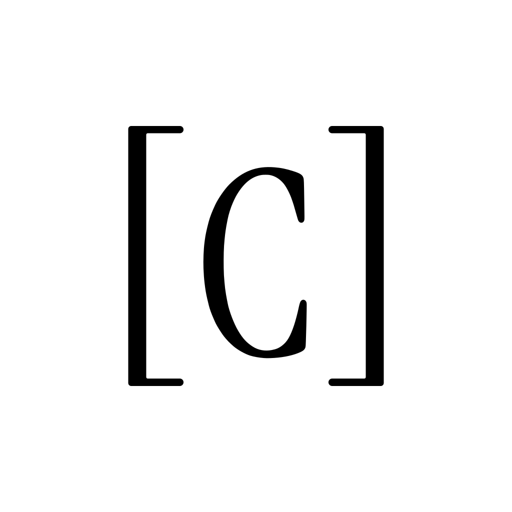

<p align="center"></p>

# Coordigent

Coordigent makes the coding agents working in the same repo aware of each other, and shows their
work to the people running them. When several agents work in one repo at once (Claude Code, Codex,
Cursor, Kiro and others), each is blind to the rest. Coordigent records what every agent is doing
and which files it is in, warns an agent before it edits a file another agent is working in, and
lets agents message each other. It never blocks an edit, never pushes, and never uploads a
transcript.

- Website: https://coordigent.com
- Documentation: https://coordigent.com/docs
- Privacy: https://coordigent.com/privacy · Terms: https://coordigent.com/terms · Security: https://coordigent.com/security

This repository holds only what you download or plug in: the installers, the npm launcher, the
Claude Code plugin, the MCP Registry entry and the versioned release binaries. Coordigent's source
is not here.

## Install

Once per machine, then once per repo:

```sh
curl -fsSL https://coordigent.com/install | sh      # macOS (Apple silicon, Intel), glibc Linux (x86_64, arm64)
coord login
coord connect
```

Windows x64 (PowerShell): `irm https://coordigent.com/install.ps1 | iex`. With Node 18 or later on
any of these: `npx coordigent connect`. Details: https://coordigent.com/docs/get-started/install

`install.sh` and `install.ps1` here are the scripts those commands run. They download `coord` and
`coord-mcp` from coordigent.com and check each against the SHA-256 the server publishes.

## Versioned downloads

Each release on this repository's Releases page carries the binaries for that version, for
macOS arm64 and x64, Linux x64 and arm64, and Windows x64, as `.tar.gz` (`.zip` for Windows)
archives and as single files, plus `SHA256SUMS`. Check a download with
`sha256sum --check --ignore-missing SHA256SUMS` (macOS: `shasum -a 256 --check --ignore-missing SHA256SUMS`).

## Claude Code plugin

```
/plugin marketplace add startupproj/coordigent-public
/plugin install coordigent@coordigent
```

On Claude Code 2.1.275 or later, one line does both: `/plugin install coordigent --marketplace startupproj/coordigent-public`.

The plugin is in `plugins/coordigent/`. It runs `coord` and `coord-mcp` from your `PATH`, so
install them first (above). Its README says what its hooks record and send:
[plugins/coordigent/README.md](plugins/coordigent/README.md).

## Other agent apps

`coord login` finds Claude Code, Codex, Cursor, Kiro and Claude Desktop on its own. VS Code with
Copilot, Windsurf, Perplexity and any other MCP client are one `coord install <client>` away:
https://coordigent.com/docs/integrations/other-clients

`server.json` is Coordigent's entry for the official MCP Registry, `com.coordigent/coordigent`. It
has two ways in: the hosted server at `https://coordigent.com/mcp`, with an
`Authorization: Bearer <token>` header carrying an agent token (make one with
`coord tokens create <name>` or in Settings > Tokens on coordigent.com), and the stdio server
through npm, `npx -y coordigent mcp`. [llms-install.md](llms-install.md) has the setup for Cline
and other clients that read it: https://coordigent.com/docs/integrations/hosted-server

## What is here

| Path | What it is |
|---|---|
| `install.sh`, `install.ps1` | The installers behind `coordigent.com/install` and `/install.ps1` |
| `npm/` | The `coordigent` npm launcher (`npx coordigent`) |
| `.claude-plugin/marketplace.json`, `plugins/coordigent/` | The Claude Code plugin and its marketplace |
| `server.json` | The MCP Registry entry |
| `llms-install.md` | Setup steps for an agent installing Coordigent's MCP server (Cline) |
| `glama.json` | The maintainers Glama's directory lists for this repository |
| `mark.svg` | The Coordigent mark |

## License

The files in this repository, apart from the Coordigent name and mark, are under the MIT license ([LICENSE](LICENSE)). The `coord` and
`coord-mcp` binaries attached to the releases, and the Coordigent service, are not: they are
provided under Coordigent's terms (https://coordigent.com/terms).

Questions and security reports: hi@coordigent.com, or https://coordigent.com/security.
